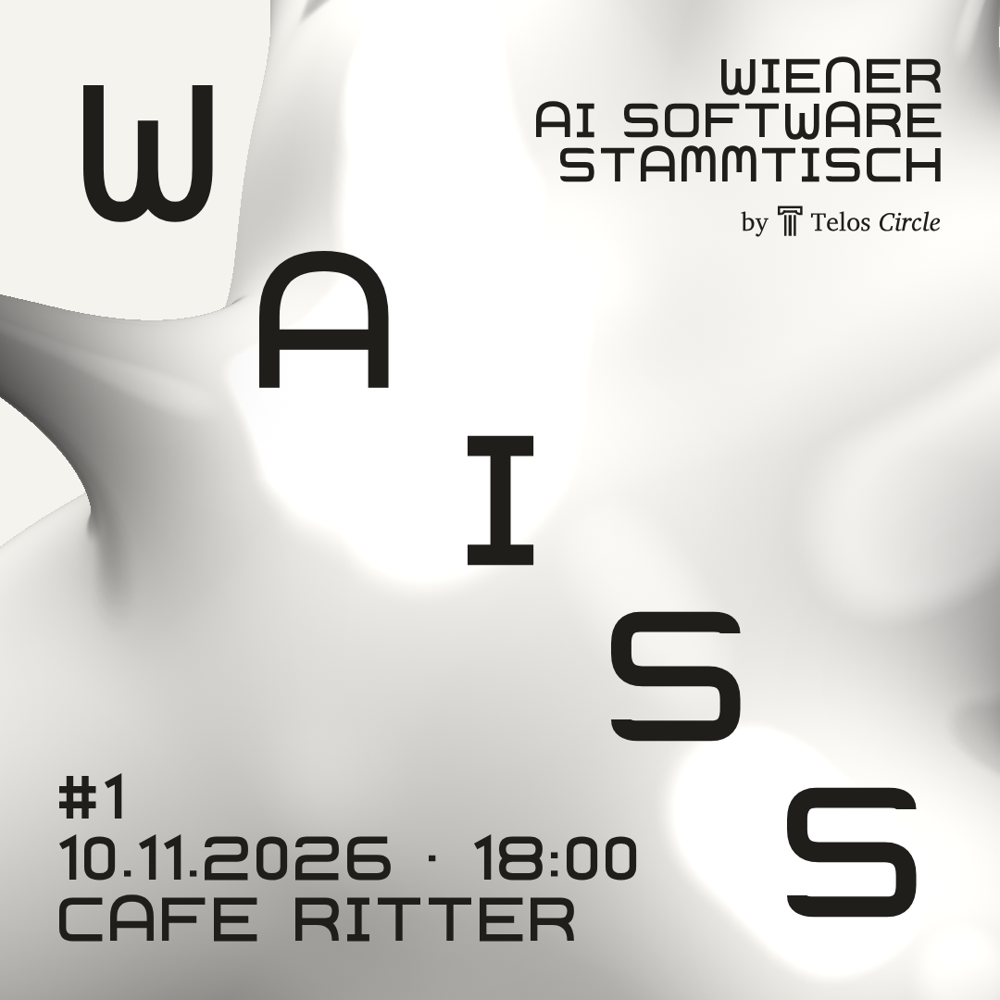

# WAISS – Wiener AI Software Stammtisch

A cozy get-together, planned monthly, for everyone in Vienna who builds, codes & experiments with AI.
Organized by [Telos Circle](https://www.teloscircle.com).

Every meetup starts with a ~20 min **AI recap** of the past month, followed by short talks
(tool tips, show & tell) and an open round.

| | |
|---|---|
| **#1** | Tue 10 Nov 2026, 18:00 · Café Ritter, Mariahilfer Str. 73, 1060 Wien |
| **Sign up** | https://luma.com/ba5jlhla |



## What's in here

```
design/canvas/   Source of truth: the design canvas files (*.dc.html) – blob, flyers, slides, wordmark
assets/logo/     Telos Circle logo (column, wordmark, "by" lockup) as clean SVGs
editions/        One JSON per meetup (edition, date, time, venue, sign-up link)
texts/           Announcement texts per edition (WhatsApp DE/EN, Luma)
exports/         Rendered PNGs per edition
tools/           render.py + screenshot.js – flyers; deck.py + export-deck.js – the slide deck;
                 site.py + site.css + site.js – the website
assets/fonts/    Self-hosted web fonts (tools/fetch-fonts.py), so neither site nor deck calls Google
docs/brand.md    Colors, wordmark, blob parameters, layout rules
```

## Rendering the flyers for an edition

Requirements: Python 3, Node 18+, Playwright (`npm install`, then `npx playwright install chromium`).

```bash
cp editions/001.json editions/002.json   # edit edition, date, time, venue, link
python3 tools/render.py editions/002.json             # -> build/002/*.html
node tools/screenshot.js build/002 exports/002        # -> PNGs
node tools/screenshot.js build/002 exports/002 2      # -> @2x PNGs
```

The `.dc.html` files use the design canvas' template syntax (`{{holes}}`, `<dc-import>`,
`data-props`). `render.py` resolves it without the canvas runtime: Secession text becomes
inline SVG, the blob becomes a `<canvas>` with the WebGL shader from `Blob.dc.html`.

## Slides

`python3 -X utf8 tools/deck.py` builds `build/deck/index.html`: one self-contained presentation where the
same blob rotates and travels between slides. Arrow keys / space / click to navigate, `F` fullscreen,
`#N` jumps to slide N. `node tools/export-deck.js` writes PNGs and the PDF fallback to `exports/deck/`
(`npm run deck` does both). Needs `pip install qrcode` for the QR codes. Layouts are the functions in
`tools/deck.py`; links and the optional `wifi` (`{"ssid", "password"}`) come from `editions/*.json`.

## Website

**https://waiss.teloscircle.com**: what WAISS is, upcoming and past editions with their Luma links, and every
edition's slides, split into its parts (Intro, AI Recap, Show & Tell, Open round). Thumbnails open the live deck
at that slide.

```bash
pip install -r requirements.txt && npm ci && npx playwright install chromium
npm run build          # deck + slide PNGs + site -> dist/
```

`tools/site.py` reads `editions/*.json`. Website fields per edition:

| Field | Meaning |
|---|---|
| `anmeldung` | Luma link ("Register" while upcoming, "Luma" afterwards) |
| `deck` | Folder name of the built deck: `build/<deck>/` and `exports/<deck>/` |
| `parts` | `[{"title", "from"}]`: a part starts at the slide named `from` (without the `NN-` prefix) |
| `talks` | `[{"title", "speaker", "html" or "file" or "url"}]`: slides people bring themselves, shown under Show & Tell |

An edition is "upcoming" up to and including its day and "past" from the next day (Vienna time). The page
decides this live in the browser, and the nightly build does the same for visitors without JavaScript.

For search engines and language models the build also writes `robots.txt`, `sitemap.xml`, JSON-LD (Organization,
EventSeries, one Event per edition), `/llms.txt`, `/llms-full.txt` and a text version of every deck (`/<n>/slides.md`),
all from the same edition data. Favicons: `favicon.svg` comes from `favicon()` in `tools/site.py`; the PNG sizes are
rendered once into `assets/icons/` with `npm run icons`.

Deployment: `.github/workflows/site.yml` builds every pull request. On `main` it pushes `dist/` (with `deploy/Dockerfile`,
nginx) to the `site` branch, which Coolify on the Telos Hetzner server serves and redeploys on every new commit.

## Contributing slides

Want to present something next time? Open a pull request, or email events@teloscircle.com.
**HTML preferred**, PPT and PDF work too.

- **In the WAISS look:** build your slides with the layouts in `tools/deck.py`. `npm run deck` also builds the
  master deck (every layout once, `build/master/`, online at waiss.teloscircle.com/master/).
- **Your own HTML deck:** put it in a folder `talks/<NNN>/<name>/` with an `index.html`.
- Then list it in `editions/<NNN>.json`:

```json
"talks": [{"title": "Agents that file my taxes", "speaker": "Your Name", "html": "talks/002/agents-taxes"}]
```

Instead of `html`, use `file` (a PDF or PPT in the repo) or `url` (a link). The pull request build shows whether
everything renders; once it is merged, the slides are live.

## Roadmap

- [ ] One folder per edition (`editions/NNN/`) with its own deck and one sub-folder per talk, so decks of past
      editions stay as they were and contributors don't edit the same file.
- [ ] Flyer generator for the next editions directly from `editions/*.json`.
